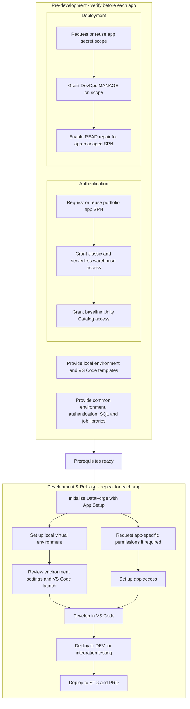

# App Development Guide

Use this guide to develop and release a Databricks App from DataForge. Complete
or verify the pre-development prerequisites before each app begins, then follow
Development & Release for that app. Reuse established portfolio resources where
available; each app does not need a new portfolio SPN or secret scope.

The [main app](../../apps/main) is a self-contained Streamlit starter providing
local environment setup, VS Code debugging, environment configuration, and common
libraries for authentication, SQL, jobs, dates, and confirmation dialogs. Home
starts without backend configuration and makes no backend calls.



## Pre-development

Before starting each app, verify these prerequisites with the platform and
deployment owners. Request only missing setup or access. The template supplies
tools and configuration but does not provision the baseline platform permissions.

### Identities and responsibilities

| Identity | Responsibility |
| --- | --- |
| Shared portfolio app SPN (Entra) | Authenticates backend SQL and workspace clients using injected credentials; needs applicable warehouse, Unity Catalog, job, and Azure permissions. |
| Databricks-managed app SPN | Created for the hosted app; reads secret resources supplying the portfolio SPN credentials. This app-local identity is targeted by scope repair. |
| DevOps deployment account | Deploys the bundle and runs permission repair; requires `MANAGE` on the app secret scope. |
| Current app user | Accesses the app; for OBO features, the user's permissions govern backend access. |

### Baseline permission request

The following requirements come from **Databricks App Setup and Access Request**
(`databricks-app-setup-request.md`). They describe requested setup across DEV,
STG, and PRD, not evidence that the grants are already applied.

`{env}` means `dev`, `stg`, or `prd`. `{tier}` is `npd` for DEV/STG and `prd`
for PRD. The BAP/OEDS Key Vault pattern retains `npd` in all environments,
as specified in the request.

Request or reuse these SPNs, add them to the corresponding workspaces, and grant
access to their portfolio's Key Vault:

| Portfolio | Service principal | Key Vault |
| --- | --- | --- |
| Triton | `lake-{env}-triton-app` | `lake-cac-{tier}-kv-{env}tri01` |
| PayCan | `lake-{env}-paycan-app` | `lake-cac-{tier}-kv-{env}pay01` |
| Currency | `lake-{env}-currency-app` | `lake-cac-{tier}-kv-{env}cur01` |
| BAP/OEDS | `lake-{env}-oedataservices-app` | `lake-cac-{tier}-kv-{env}oed01` |

Grant all these app SPNs access to the following warehouses in each environment:

| Warehouse | Request note |
| --- | --- |
| `serverless-large` | Serverless warehouse access. |
| `serverless-small` | Reported as missing in STG in the supplied request; verify availability before promotion. |
| `uc-medium` | Classic warehouse access. |

Grant each portfolio app SPN **read access to all objects, including volumes**,
within its listed catalogs and schemas:

| Service principal | Catalogs / schemas |
| --- | --- |
| `lake-{env}-triton-app` | `{env}_financial_markets_cat`<br>`{env}_application_cat.yield_curve_db`<br>`{env}_application_cat.oedataservices_db` |
| `lake-{env}-paycan-app` | `{env}_oversight_cat`<br>`{env}_application_cat.oedataservices_db` |
| `lake-{env}-currency-app` | `{env}_oversight_cat`<br>`{env}_application_cat.oedataservices_db` |
| `lake-{env}-oedataservices-app` | `{env}_banking_and_payments_cat`<br>`{env}_application_cat.oedataservices_db` |

Request or reuse the app credential scopes and grant **MANAGE** to these
DevOps accounts in each corresponding workspace:

| Secret scope | DevOps account |
| --- | --- |
| `lake-kv-tritonapp-scope` | `{env}_spn_devops_triton` |
| `lake-kv-paycanapp-scope` | `{env}_spn_devops_paycan` |
| `lake-kv-currencyapp-scope` | `{env}_spn_devops_currency` |
| `lake-kv-oedataservicesapp-scope` | `{env}_spn_devops_oedataservices` |
| `lake-kv-oedataservicesapp-scope` | `{env}_spn_devops_bap01` |

### Why scope management and READ repair are required

The platform permission-management script can remove the Databricks-managed
app SPN's secret-scope access. The dedicated app scope and DevOps `MANAGE` grant
allow `restore_app_secret_access` to restore `READ` for that identity before
deployment. Without this access, the hosted app cannot read its credential
secrets even when the portfolio SPN has the correct backend permissions.

The template selects this repair hook for DEV, STG, and PRD. It acts only when
invoked; later platform cleanup can remove access again. On first deployment,
an app absent from the workspace inventory is skipped because its managed SPN
does not exist yet. Keep the declared secret resource bindings for initial setup.
See [Restoring app secret-scope access](#restoring-app-secret-scope-access) for
exact behavior and manual invocation. Repair does not grant backend permissions
to the portfolio SPN or configure end-user app access.

### Shared development support

DataForge supplies the Conda setup script and configuration, additional package
requirements, VS Code launch configuration, environment-file example, and reusable
app libraries. Verify that these are available in the copied template and that
developers have approved Conda tooling, VS Code Python extensions, and corporate
package-repository access. Use these supplied assets during each app's setup.

## Development & Release

### Initialize the app

Follow the [Init Project Guide](G101-init-project-guide.md) and
[init-project skill](../../.agents/skills/init-project/SKILL.md) in a **copied
project bundle**, never in the canonical DataForge template. Initialization runs
once: if `databricks.yml` exists, including after an interrupted attempt, stop and
review that output instead of overwriting it or rerunning setup. The copied
`default.databricks.yml` must be present as the configuration source.

The skill displays existing DataForge version metadata when available, then
runs these sections in order:

| Section | Developer input and result |
| --- | --- |
| General (always) | Confirm `bundle.name` and the complete `project` object: `team`, `domain`, `tag`, `catalog`, `dataset`, and `raw_path`. Resolve shared domain mappings, including `app_secrete_scope`, and include shared scripts. |
| Job (optional) | Answer **Set up jobs?** Enable this only when the project needs bundle jobs. If enabled, select optional jobs alongside mandatory jobs, confirm job identities, and select job compute and any applicable classic cluster policy. |
| App (optional) | Answer **Set up a Databricks App?** with **Yes** for this workflow, then complete the app choices below. |

App-only initialization is supported: decline Job Setup and enable App Setup.
There are no job-selection, compute-selection, or cluster-policy prompts in that
case. Required jobs, including `SERVICE`, are mandatory only when Job Setup is
enabled. Job compute configuration is separate from the app's SQL warehouse.

During enabled App Setup:

1. Supply the app name without its domain prefix. The skill uses the confirmed
   project domain to infer the full lowercase name and description. Confirm both
   values together or provide replacements. The full name must be 2-30 lowercase
   ASCII letters, digits, or hyphens; the description must be 1-500 characters.
2. Select a SQL warehouse from the app resource's `app_sql_warehouse` metadata.
   One choice applies across DEV/STG/PRD using each target's existing warehouse
   ID. Explicitly accept a choice or the recommended default; a preselected
   option alone does not complete the selection.
3. The skill automatically resolves all nine SPN secret-key placeholders from
   the domain's `app_spn_keys` mapping: three existing key names per environment.
   No key-entry or key-confirmation prompt is needed. Missing, incomplete, or
   conflicting mappings stop setup for correction; credentials are never fetched.
4. Select one already enabled bundle job or **No job access**. The latter omits
   `JOB_ID`; with no enabled jobs and no explicit choice, it applies without a
   prompt. A selected job creates a hosted bundle job-ID binding, not a permission
   grant or a lookup of its deployed ID.
5. The skill configures the copied app resource, includes it exactly once, and
   removes only the broad `apps/**` and `resources/apps/**` sync exclusions.
   The private `.vscode.env` exclusion remains in place.

App Setup creates `apps/main/.vscode.env` from its example using effective DEV
settings and the confirmed warehouse selection. It preserves an existing file
without reading its credentials. Each field follows the example's setup metadata;
unavailable values retain the example value or remain blank. Review reported
defaulted fields and fill in credentials and deployment-dependent job IDs locally.
Initialization does not create the Conda environment, select the VS Code
interpreter, deploy the app, start it, or run deployment hooks.

### Verify initialization completed

After both optional setup decisions, initialization filters existing deployment
hook selections according to their metadata and enabled sections. It preserves
selected script order and never adds an unselected hook. Declining App Setup
leaves the app resource unchanged and excluded, preserves its broad sync
exclusions, skips local environment-file generation, and removes app-dependent
hooks. General still resolves the shared app scope.

The skill synchronizes existing `common.py` fallbacks from effective DEV values,
even for app-only projects, and validates the active configuration, resource
references, mappings, script selections, and generated local settings. Only after
all checks pass does it remove the copied `default.databricks.yml`. Other source
YAML, provenance, and inherited documentation are preserved. Validation or cleanup
failure must be reported as incomplete initialization, with written outputs and
remaining sources identified.

Check the completion summary for the generated `databricks.yml`, removed default,
Job/App decisions, and whether `.vscode.env` was created or preserved, including
populated/defaulted/skipped field names. Future changes belong in active
`databricks.yml`, resource files, and corresponding `common.py` fallbacks; do not
rerun initialization. Keep project-specific documentation under `docs/project/`.

### Set up the local environment and VS Code

Open `apps/main` in VS Code and follow the
[local development README](../../apps/main/README.md). In PowerShell:

```powershell
.\conda_venv_setup.cmd
conda activate databriks-app-3.11
```

Select the `databriks-app-3.11` interpreter. Review `.vscode.env`, fill in locally
required credentials, and supply a deployed `JOB_ID` only if needed. Keep this
file ignored by Git and excluded from bundle synchronization.

Use the supplied **DataForge: Debug Streamlit** launch configuration and press
**F5**. It loads `.vscode.env` and runs the app from the correct folder; no new
launch configuration is required. Restart debugging after changing settings.
Local launches do not supply hosted forwarded user headers or an OBO token.

### Configure additional permissions and app access

In parallel with local setup, identify permissions beyond the shared baseline,
such as data writes, additional catalogs or volumes, job operations, or Azure
resources. Request them for the identity used by the feature. Selecting an
optional job binding configures its ID; it does not itself grant permissions.

Configure intended users' access to the hosted app and feature-specific
authorization. The template's support-group `CAN_MANAGE` grants do not define
application user roles. OBO features require applicable user authorization and
backend permissions. Forwarded user metadata alone is not authorization. See
[Pages and request context](#pages-and-request-context) and
[Backend clients](#backend-clients).

### Develop in VS Code

Add pages and project services using the supplied libraries. Keep backend clients
explicit and test each feature with its intended authentication mode. Confirm
Home renders without backend settings, then test configured SQL, job, and other
operations. The technical reference below describes settings, request context,
and library responsibilities.

### Deploy to DEV and integration-test

Use the v3 pipeline in the [Deployment Guide](G112-deployment-guide.md), selecting
the generated bundle's path, `target_wks: UC01`, and `target_env: dev`. Confirm
the app resource is enabled, credential keys exist, and the deployment identity
has scope `MANAGE`.

The pipeline runs the selected pre-deployment repair, deploys the bundle, and
runs `start_app` after successful deployment. Plain `bundle deploy` does not
invoke these hooks automatically.

Verify initial startup, runtime secret injection, intended user access, and each
enabled backend feature. Also verify redeployment after the app-managed SPN's
scope grant has been removed in a controlled DEV test. Startup success alone
does not establish that application-level integration tests passed.

### Promote to STG and PRD

After DEV integration testing, deploy the reviewed release to STG and then PRD
through the same pipeline with the corresponding `target_env`. Keep UC01 as the
workspace. Verify each environment's prerequisites, keys, warehouse availability,
app access, and backend permissions before promotion; smoke-test after deployment.

Follow the [Release Guide](G111-release-guide.md) for release documentation and
required data changes. Its `SERVICE` job and release notebooks apply when those
operations are needed and the job is enabled; they are not required just to start
an app.

## Technical reference

### Ownership and layout

| Location under `apps/main` | Responsibility |
| --- | --- |
| `app.py` | Page configuration, sidebar navigation, and current user display. |
| `pages/home.py` | Initial page; add project pages alongside it. |
| `libs/app/environment.py` | Immutable workspace and backend settings. |
| `libs/app/context.py` | Current forwarded user metadata and token. |
| `libs/common/core/sql.py` | Explicitly configured `DatabricksSQLClient`. |
| `libs/common/core/job.py` | Job operations using a supplied workspace client. |
| `libs/common/core/workspace.py` | Explicit AAD or current-user token workspace authentication. |
| `libs/common/core/utils.py` | Date formatting, parsing, and previous-weekday helpers. |
| `libs/common/ui/confirm_dialog.py` | Confirmation callbacks with one execution per opening. |

Common libraries do not import project settings or request context. Project code
may import common libraries. Keep business services under `libs/app` as needed;
do not add placeholder service classes. The common code is copied into each
project, with no runtime dependency on a sibling bundle or central package.

### Local startup and settings

Follow the [app development README](../../apps/main/README.md) for corporate Conda
prerequisites, dependency management, VS Code interpreter selection, and debugging.
Open the generated project's `apps/main` directory in VS Code. From PowerShell:

```powershell
.\conda_venv_setup.cmd
conda activate databriks-app-3.11
```

Setup creates or updates the environment using `conda_venv_config.yml`, installs
additional packages from `requirements.txt`, and checks dependency compatibility.
The environment matches the three documented Databricks Apps library versions.
The hosted requirements file currently contains only comments; Databricks uses
its preinstalled libraries and does not consume the local environment file.

Enabled `init-project` App Setup creates `.vscode.env` automatically from
`.vscode.env.example` using resolved dev workspace settings, the selected
warehouse, and the project catalog. It preserves an existing local file unchanged.
Unresolved values retain the example default or remain empty; secret bindings
are not resolved and deployed job IDs are not queried. Review defaulted fields
and fill in credentials locally before using backend features.

For manual setup, copy `.vscode.env.example` to `.vscode.env` only when the local
file is absent, then adjust its settings. Keep credentials in the ignored local
file. Select the environment's interpreter and
use **DataForge: Debug Streamlit** with F5 to load `.vscode.env` through VS Code.
Terminal activation is separate from interpreter selection. Keep the
`apps/main/.vscode.env` synchronization exclusion when enabling app deployment.

`Environment.from_env()` loads optional settings when the module initializes and
creates the immutable `ENV` snapshot. Restart the app after changing settings.
Validation does not authenticate, connect to SQL, or check that resources exist.
Missing or blank settings are unset. Invalid supplied values still fail validation.

| Source | Optional properties |
| --- | --- |
| Process environment | `DATABRICKS_WORKSPACE_ID`, `DATABRICKS_HOST`, `JOB_ID`, `SPN_TENANTID`, `SPN_ID`, `SPN_SECRET` |
| Process environment | `ENV_NAME`, `DATABRICKS_WAREHOUSE_ID`, `UC_CATALOG_NAME`, `AZURE_WORKSPACE_RESOURCE_ID` |

Backend properties default to `None`. A supplied nonblank `JOB_ID` must parse as a positive integer.
App Setup can bind one enabled bundle job to `JOB_ID`; **No job access** is the default and omits the binding. Local job operations require a deployed job ID.
SQL authentication is selected explicitly for each client using its `auth_mode`
argument: `aad` or `obo`. There is no application-wide authentication
mode. SQL and job clients validate the properties required for their operation when constructed.

The loader reads each setting directly from its process environment variable.
Missing or blank settings remain `None`, and the workspace ID does not select
configuration. Legacy `ENV_<workspace_id>` JSON variables are ignored; migrate
local launchers and existing app configurations to the individual variables
when adopting this loader. Errors name the invalid setting without including
its value. SPN fields are excluded from `repr(ENV)`, but the settings
object still contains credentials: never serialize or log it. User identity and
tokens remain in the separate request context.

Streamlit does not load `app.yml` for a local launch. Home needs no environment
variables; after installing Streamlit, run:

```powershell
conda run -n databriks-app-3.11 python -m streamlit run app.py
```

Configure only the settings needed by your project features. The optional example
below shows workspace configuration. Supply credentials through your secure local
launcher when constructing a service-principal client:

```powershell
$env:DATABRICKS_WORKSPACE_ID = '<workspace-id>'
$env:DATABRICKS_HOST = '<workspace-hostname-without-https>'
$env:JOB_ID = '<positive-job-id>'
$env:ENV_NAME = 'local'
$env:DATABRICKS_WAREHOUSE_ID = '<warehouse-id>'
$env:UC_CATALOG_NAME = '<catalog-name>'
$env:AZURE_WORKSPACE_RESOURCE_ID = '<azure-workspace-resource-id>'
conda run -n databriks-app-3.11 python -m streamlit run app.py
```

Hosted settings come from `resources.apps.MAIN.config` in the
[app resource template](../../resources/apps/main.yml) and the Databricks runtime.
The source [app.yml](../../apps/main/app.yml) is an empty placeholder. Configure
the catalog before enabling app deployment. The warehouse ID
and Azure workspace resource ID come directly from the target bundle variables
selected during App Setup (default: `sql_warehouse_serverless_small_id`) and
`internal_databricks_resource_id`, respectively.
Do not store credential values in YAML or source files.

### Pages and request context

Create a page in `pages/` and register it with `st.Page` in `app.py`. Keep Home as
the default page and use `st.navigation` for routing. Use `st.text` for forwarded
user metadata, so it is not interpreted as markup. Avoid displaying process
environment variables or raw backend exception messages.

Call `RequestContext.current()` during each page execution that needs user
metadata. It reads the current forwarded username, email, user ID, and token;
missing headers remain `None`. Do not store this context, its token, or an OBO
client in session state, a global variable shared across requests, or a Streamlit
resource cache. The token is excluded from the context's representation, but is
still sensitive and must not be serialized or logged.

Forwarded display identity does not grant application permissions. This starter
has no role model or authorization database. Before adding privileged actions,
implement project-specific authorization in the backend service as well as page
access checks. Local headers are not evidence of a trusted hosted identity.

### Backend clients

Construct clients explicitly inside project services when a feature needs them.
Do not instantiate them at shell startup. For the SQL client, supply a hostname without `https://`
and obtain secrets from deployment resources or your local credential provider.

`DatabricksSQLClient` takes `host`, `warehouse_id`, optional `catalog`, and an
explicit `auth_mode`:

- `aad`: Entra client credentials using `tenant_id`, `client_id`, and
  `client_secret`. Use `aad` for Azure Active Directory (Entra) authentication.
- `obo`: the current request's Databricks access token in `user_token`. Enable
  the required hosted user authorization and SQL permissions for this feature.
  There is no fallback to service credentials if user authentication fails.

The SQL constructor validates settings without connecting. `query(statement,
parameters=...)` returns a pandas DataFrame; `execute(statement, parameters=...)`
executes one command. Bind values through parameters rather than interpolating
SQL. Each call owns its connection; multiple calls do not share a transaction.
`query` does not enforce read-only SQL. Query sessions use UTC timestamps.

`DatabricksJobClient` takes a caller-owned SDK `client` and positive integer
`job_id`. Create the workspace client separately with
`libs.common.core.workspace.create_workspace_client()`. The factory accepts a
hostname or HTTPS workspace URL and normalizes it to an HTTPS origin. It rejects
URL paths, embedded credentials, query strings, fragments, non-HTTPS schemes,
and ports other than 443.

Select authentication explicitly with case-insensitive `auth_mode`:

- `aad`: requires `resource_id`, `tenant_id`, `client_id`, and `client_secret`;
  uses SDK `azure-client-secret` authentication.
- `obo`: requires the current request's forwarded Databricks token in
  `user_token`, without a Bearer prefix. The SDK's `pat` strategy sends this token
  directly; the forwarded OAuth token need not be a personal access token.

Only credentials for the selected mode are validated and supplied. There is no
fallback, token exchange, refresh, or global client cache. Header extraction and
secret lookup belong to the app layer. Keep OBO clients scoped to the current
request; never share them between users. User permissions and configured app
authorization scopes still govern API access. SDK errors propagate to the caller.

Migrate existing job-client construction by moving the former credential
arguments to the workspace factory and passing its result as `client`:

```python
from libs.common.core.job import DatabricksJobClient
from libs.common.core.workspace import create_workspace_client

workspace = create_workspace_client(
    host=workspace_host,
    auth_mode="aad",
    resource_id=workspace_resource_id,
    tenant_id=tenant_id,
    client_id=client_id,
    client_secret=client_secret,
)
jobs = DatabricksJobClient(client=workspace, job_id=operation_job_id)
```

For current-user authentication, construct a request-scoped client instead:

```python
workspace = create_workspace_client(
    host=workspace_host,
    auth_mode="obo",
    user_token=context.user_token,
)
jobs = DatabricksJobClient(client=workspace, job_id=operation_job_id)
```

The former credential arguments to `DatabricksJobClient` are no longer accepted.
Job operations and SQL authentication remain unchanged. Live AAD/OBO verification
requires deployment credentials and a user-authorized app session.

`run(job_parameters=..., idempotency_token=...)` returns a submitted run ID;
reuse the token when retrying the same logical submission. `cancel` requests
asynchronous cancellation. Run lookup/status methods preserve the copied client
contract: `RUNNING`, `FAILED`, or `SUCCESS`, original parameter names and values,
millisecond timing fields, and available task failure details. A
`SUCCESS_WITH_FAILURES` result maps to `SUCCESS` and may include `task_error`.
Treat task errors and parameters as potentially sensitive; do not display or log
them indiscriminately. SDK and SQL failures propagate to the caller.

The date helpers retain their existing behavior. `get_last_weekday` returns the
previous Monday-to-Friday date strictly before the supplied date, without holiday
calendar handling.

For confirmations, call `confirm_dialog.show` only inside the action branch that
opens the dialog. Provide a stable key and an `on_confirm` callback. Explicit
Cancel may invoke `on_cancel`; dismissing the dialog does not. A callback is
consumed before execution, so failures propagate without executing it twice in
the same opening. This UI behavior is not backend idempotency or authorization.

### Bundle app configuration and activation

The [app resource template](../../resources/apps/main.yml) owns the app's command,
environment, and resource bindings. It uses `${var.app_name}` and points to
`apps/main`. During App Setup, the name is inferred from the confirmed project
domain and user-provided app name as `<domain>-<app name>`, lowercased with
whitespace replaced by hyphens (for example, `fmd-client-portal`). Confirm a valid
Databricks App name during setup; customize `app_name` in the generated project's
`resources/apps/main.yml` when needed.

Target-specific app permissions grant `CAN_MANAGE` to
`lake_aeengsupport_rusr_inda` in dev and `lake_aeengsupport_rusr_inpa` in staging
and production. These grants are defined under each target's `resources.apps.MAIN`
in the app resource template.

When adding an environment variable under `resources.apps.MAIN.config.env`,
choose its source according to the value the app needs:

| Field | Use for | App resource binding required? |
| --- | --- | --- |
| `value` | Literal strings or bundle substitutions such as `${var.catalog}` | No |
| `value_from` | A named resource declared in this app's `resources` list | Yes |

For example, these entries belong under the app's `config`:

```yaml
env:
  - name: STREAMLIT_BROWSER_GATHER_USAGE_STATS
    value: "false"
  - name: UC_CATALOG_NAME
    value: "${var.catalog}"
  - name: SPN_TENANTID
    value_from: spn-tenantid
```

Bundle substitutions resolve configuration values during deployment. Databricks
makes the configured environment variables available when the app starts; Python
reads them through `os.environ`, for example `os.environ["SPN_TENANTID"]`.
For a secret resource, `value_from` injects the secret's value. The bundle variable
`app_spn_tenantid_key` contains only its key name: passing it through `value`
would give the app that name, not the tenant ID stored in the secret. Use the
secret resource binding for credentials instead of placing secret values in YAML.

Use `value_from` in this bundle resource file. The `valueFrom` spelling used in
standalone app configuration does not apply here. See the
[app environment-variable documentation](https://learn.microsoft.com/en-us/azure/databricks/dev-tools/databricks-apps/environment-variables)
for resource-value resolution.

Remove unused bindings and resources in generated projects that do not need
them. Optional Python settings do not provision deployment resources:

| App resource | Environment variable | Permission |
| --- | --- | --- |
| `spn-tenantid` | `SPN_TENANTID` | `READ` on the configured secret |
| `spn-id` | `SPN_ID` | `READ` on the configured secret |
| `spn-secret` | `SPN_SECRET` | `READ` on the configured secret |

Before enabling app deployment, configure `resources/apps/main.yml`:

- `UC_CATALOG_NAME` uses `${var.catalog}`, and `ENV_NAME`
  comes from `${bundle.target}`. Databricks supplies the host and workspace ID at
  runtime. The loader does not use the workspace ID to choose settings, so deploy
  the target to its intended workspace.
- `DATABRICKS_WAREHOUSE_ID` defaults to
  `value: "${var.sql_warehouse_serverless_small_id}"`. App Setup offers a structured
  choice from the adjacent `app_sql_warehouse` comment metadata, which owns
  the options, default, and variable mappings: serverless-small (recommended
  default), serverless-large, or
  uc-medium (classic), using `sql_warehouse_serverless_small_id`,
  `sql_warehouse_serverless_large_id`, or `sql_warehouse_classic_medium_id`,
  respectively. One selection applies across dev/stg/prd; each bundle target
  supplies its existing warehouse ID directly.
- Optional `JOB_ID` is configured from the adjacent `app_job_access` comment
  metadata during App Setup. Choose one enabled bundle job or **No job access**
  (default). For example, selecting `DATAFLOW` writes
  `value: "${resources.jobs.DATAFLOW.id}"`; the default omits the environment
  entry. Disabled jobs are not choices. With no enabled jobs, no prompt is needed.
  When Job Setup is enabled, the domain app SPN receives `CAN_MANAGE_RUN` through the shared job permission
  mappings on all enabled jobs, regardless of this selection or App Setup.
  Calls must authenticate with that domain SPN to use these grants; OBO calls
  use the user's permissions. Job run-as identities remain unchanged.
- `AZURE_WORKSPACE_RESOURCE_ID` uses
  `value: "${var.internal_databricks_resource_id}"`. The dev/stg/prd bundle
  targets supply the Azure resource ID for the internal workspace directly.
  Neither setting requires an app secret resource or OEDS secret-scope access.
- App Setup resolves `app_spn_tenantid_key`, `app_spn_id_key`, and
  `app_spn_secret_key` automatically from the `app_spn_keys` comment mapping in
  `resources/apps/main.yml`, using the confirmed domain and each dev/stg/prd
  target. These are existing secret key names, never secret values. Missing,
  incomplete, unresolved, or conflicting mappings must be corrected before
  initialization finishes; setup does not retrieve credentials or create secrets.
- General setup resolves `app_secrete_scope` from the domain mapping in
  `default.databricks.yml`: FMD uses `lake-kv-tritonapp-scope`, CUR uses
  `lake-kv-currencyapp-scope`, SUP uses `lake-kv-paycanapp-scope`, and BAP/OEDS use
  `lake-kv-oedataservicesapp-scope`. It is not derived from `project.tag`.
  The literal scope name is inherited by all targets. Preserve the existing
  `secrete_scope` spelling. Declaring this variable does not provision a scope,
  Key Vault, or secrets, and it is not passed to job context.

DataForge apps deploy to **UC01 only**. Select `target_wks: UC01` in the v3
pipeline wrapper so the runtime workspace matches the configured internal
workspace resource ID and SQL warehouse.

The default job bundle does not activate the app: `apps/**` and
`resources/apps/**` remain excluded from synchronization, and no app resource
include is added. Project initialization must later select the app resource,
allow its source files to sync, and supply its required variables. The existing
initialization workflow is unchanged. The v3 pipeline selects `start_app` after
successful deployment to start configured apps. An empty `app.yml`
does not provide a standalone launch command; hosted deployment must supply the
bundle configuration. A bundle deployment provisions the resource and syncs
files; `databricks bundle run MAIN --target <target>` starts or restarts the app.

### Starting Bundle Apps

The `start_app` script in [resources/apps/main.yml](../../resources/apps/main.yml)
is selected by `post_deploy_scripts` for dev, staging, and production. It receives
`DEPLOY_TARGET`, validates the bundle with JSON output, and invokes
`databricks bundle run <resource-key> --target <target>` for each configured app,
in alphabetical resource-key order. The resource key can differ from the deployed
app name. Each command starts or restarts the app with its latest deployed code.

No configured apps is a successful no-op. Validation, JSON parsing, or command
failures stop execution without retrying or rolling back earlier requests.
The script waits for each CLI command to complete. The CLI waits for app
startup when needed and for the app deployment to complete, propagating startup
or deployment failures to the script. Success confirms completion of those CLI
operations; no separate application-level smoke test is performed. The deployment
agent's CLI and inherited authentication are used without a Python Databricks SDK
dependency.

The v3 pipeline invokes the post-deploy hook only after successful deployment;
plain `bundle deploy` does not invoke it. Startup selection does not include app
resources or enable source synchronization. Use target configuration or inherited
`BUNDLE_VAR_*` overrides; outer `--var` arguments are not forwarded to nested
validation or run commands. To invoke startup explicitly:

```powershell
databricks bundle run start_app --target dev
```

### Restoring app secret-scope access

The optional `restore_app_secret_access` script in
[resources/apps/main.yml](../../resources/apps/main.yml) runs inline Python on the
deployment agent using the installed Databricks CLI and its authentication.
No Python Databricks SDK is required. Use a CLI version supporting `scripts.env`
(the v3 pipeline requires 1.8.0 or later).

The script resolves the selected bundle with `bundle validate --output json`,
finds all configured apps by their resolved names, and reads the workspace app
inventory through `apps list --output json`. The CLI follows all inventory pages.
For each matching app, it uses `service_principal_client_id` to apply `READ` to
`APP_SECRET_SCOPE`, supplied from `${var.app_secrete_scope}`. It does not query
existing ACLs or retrieve secret values. Apps absent from the inventory are
skipped, allowing first-time deployment; a bundle without app resources is a
successful no-op. The deployment identity must retain visibility of all bundle
apps so an inaccessible app is not mistaken for an absent one.

Bundle validation, inventory, invalid principal metadata, and permission-grant
failures stop the script. An earlier successful grant is not rolled back if a
later app fails. The deployment identity needs `MANAGE` on the secret scope.
`READ` replaces the app principal's existing explicit scope permission, even if
it was `WRITE` or `MANAGE`, and applies to all secrets in that scope. Keep only
app-appropriate credentials in the app scope.

The repair script only handles `app_secrete_scope`, which supplies the three
SPN secret bindings. The workspace resource ID and warehouse ID use direct
bundle values and require no secret-access repair.

The default selections run `restore_app_secret_access` before deployment and
`start_app` afterward for dev, staging, and production when App Setup is enabled.
DEV also selects `deploy_databench_config` first; its metadata restricts it to DEV
but does not require Job Setup, so app-only initialization retains it when selected.
Initialization filters existing selections using the target and setup conditions;
it never adds unselected scripts. Selection variables, rules, and target overrides
are centralized in [default.databricks.yml](../../default.databricks.yml).
This selection does not enable app deployment: repair is a successful no-op
when no apps are configured. In initialized projects, edit the active
`databricks.yml`, preserving the full ordered list when adding scripts because
overrides replace the whole list. To invoke the repair explicitly:

```powershell
databricks bundle run restore_app_secret_access --target dev
```

Use target configuration or inherited `BUNDLE_VAR_*` environment variables for
overrides needed by the nested bundle validation; an outer command's `--var`
arguments are not forwarded. Repair happens only when invoked; later platform
cleanup can remove the grant again. A new app is skipped until its managed
service principal exists; keep the declared secret resources for initial setup.

The app-managed Databricks principal reads the credential secrets. The injected
Entra service principal remains the backend client identity. Resource bindings
and scope repair do not grant that Entra principal warehouse, catalog, job, or
Azure resource permissions. Configure those permissions separately. Before
promotion, test initial deployment, re-deployment after ACL removal, runtime
secret injection, and enabled backend features in a development workspace.

### Local verification

Launch the app locally without backend settings and confirm that Home renders
with the fixed `DataForge` title. Configure the optional workspace values,
restart the app, and confirm that the environment label reflects `ENV_NAME`.
Customize the title directly in `app.py` and `pages/home.py` when needed.

Verify backend features in a development workspace using the authentication mode
and permissions intended for each client. Existing generated projects need their
own reviewed migration from the legacy app imports.
