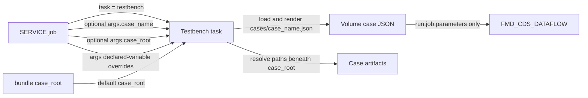

# Integration Test Guide

DataForge Testbench is the DataForge integration-test framework. It creates a
temporary Unity Catalog environment, runs a Databricks job, validates its
outputs, tears down the configured resources, and invokes a report stage through
`TestbenchRunner`.

This guide records the contract for test-case definitions and artifacts stored
together in a Unity Catalog Volume configuration zone.

## Volume-Backed Configuration And Data

Case definitions are JSON files under `<case_root>/cases`. Testbench loads
`cases/<case_name>.json` exclusively from the Volume and does not fall back to
a packaged case definition.

By default, Testbench uses the bundle's shared integration-test root:

```text
${var.config_root}/testbench
```

A run may override this location with `args.case_root`. Multiple cases may share
the resolved root, so their fixture and expected-data paths must avoid
unintended collisions. All artifact paths in a case definition are
forward-slash relative paths beneath `case_root`.

## Case Variables And Inheritance

A case may define reusable values in an optional top-level `variables` object.
Reference them from JSON string values with `{{ variable_name }}` syntax:

```json
{
  "variables": {
    "catalog_name": "tst_financial_markets_cat",
    "standardized_schema_name": "standardized_db",
    "customer_table_name": "tbl_customer"
  },
  "validate": {
    "verifications": [
      {
        "name": "customers_match",
        "type": "table_equals_file",
        "actual": {
          "table": "{{ catalog_name }}.{{ standardized_schema_name }}.{{ customer_table_name }}"
        },
        "expected": {
          "format": "parquet",
          "path": "expected/customers_match"
        }
      }
    ]
  }
}
```

Variable names must start with a letter or underscore and contain only letters,
numbers, or underscores. Default values must be strings. Names reserved as
Jinja2 literals or operators cannot be used.

The parsed SERVICE `args` object is the runtime variable context. A non-null
string value overrides the default only when the case declares a variable with
the same name. An absent or null value retains the default, while an empty
string is an explicit override. Unrelated context keys are ignored, and a
matching number, boolean, object, or array raises `TypeError`.

For example, a case default of `"rundate": "2026-05-01"` is overridden by
`"rundate": "2026-06-01"` in SERVICE `args`. The runtime value affects only
case fields that reference `{{ rundate }}`; it is not otherwise forwarded to
the target job.

Variable definitions must be literal strings and cannot reference other case
variables. Testbench rejects a `{{ name }}` reference inside a variable
definition. After removing the top-level `variables` object, Testbench
serializes the merged config, renders all placeholders in one Jinja2 pass, and
parses the result back to JSON. Variable values are JSON-escaped before
rendering, so quotes, backslashes, and newlines remain valid string content.

Only simple `{{ name }}` placeholders are supported. The `{{ ... }}` syntax is
reserved for case variables; Jinja expressions, filters, and dotted names are
outside the supported contract. Other marker families such as `${var.*}` and
`[[ ... ]]` remain unchanged. Undefined variables and rendering errors fail
case loading.

Testbench first loads the complete relative `extends` chain. Parent and child
variable objects merge by name, with the child default winning. Matching runtime
context then overrides the merged defaults before template rendering. The
`extends` value itself must therefore remain a literal relative path; a case
variable cannot select the parent file. Consequently, a child can change all
inherited references without copying the parent structure:

```json
{
  "extends": "base.json",
  "variables": {
    "catalog_name": "tst_financial_markets_cat"
  }
}
```

Other fields keep the shared configuration loader's merge behavior. Nested
objects merge by key, while a conflicting list in the child replaces the parent
list rather than appending to it.

## Case Data Layout

Use this shared integration-test layout:

```text
<case_root>/
├── cases/
│   ├── default.json
│   └── another_case.json
├── fixtures/
│   ├── tbl_customer/
│   │   ├── part-00000-....snappy.parquet
│   │   └── part-00001-....snappy.parquet
│   └── tbl_account/
│       └── part-00000-....snappy.parquet
├── inputs/
│   ├── customers_2026_05_01.csv
│   └── incoming/
│       └── customer.xml
├── expected/
│   └── tbl_customer_matches_expected/
│       └── part-00000-....snappy.parquet
└── logs/
    └── 20260830T123456_123456789/
        └── default_987654321.log
```

### `cases/`

`cases/<case_name>.json` contains the environment, job run, validation, and
teardown definition selected by `args.case_name`, or `default` when omitted.
Relative
`extends` references are resolved from the child JSON file's directory through
DataKit's configuration loader.

### `fixtures/`

`fixtures/<table>/` contains the data used to create a table during environment
setup. Parquet is the only supported table-fixture format. Keep
`source.format` explicit in the case JSON and point `source.path` at the
Parquet directory, not at a specific part file.

The table directory should normally use the configured Unity Catalog table
name, such as `fixtures/tbl_customer`.

### `inputs/`

`inputs/` contains files copied into configured test Volumes before the job
runs. These files may use the format required by the pipeline, and `from` may
identify one file, a directory, or a glob. The `to` value remains a destination
inside the configured test Volume and is not resolved beneath `case_root`.

### `expected/`

Use `expected/<verification-name>/` for validation artifacts. Naming by the
unique verification name avoids collisions when several checks target the same
table. Parquet is recommended for tabular expected results because it preserves
Spark types. The `table_equals_file` validator also supports CSV and Delta when
a test specifically requires them.

## Exporting Table Artifacts

Configure authoring recipes in the case's top-level `artifacts` list. Each
artifact has a unique `name`, raw Spark `sql`, an `output_path` beneath
`fixtures/` or `expected/`, and an `export_mode` of `schema` or `data`.

Run `tools/testbench_export_artifacts` directly and populate its `args` widget:

```json
{
  "artifact_name": "customer_fixture",
  "overwrite": false,
  "rundate": "2026-06-01"
}
```

The notebook defaults `case_name` to `default` and `case_root` to the bundle's
configured value; explicit properties override those values. It passes the
complete `args` object to `load_test_case`. Properties matching declared case
variables, such as `rundate`, override their defaults before artifact SQL and
other case fields are rendered. Control properties such as `case_root`,
`case_name`,
`artifact_name`, and `overwrite` are ignored unless the case declares variables
with those names.

`schema` mode writes a zero-row SQL result so Testbench can create an empty
managed table with the same Spark columns and types. `data` mode writes every
row returned by the configured SQL and can therefore create either populated
setup fixtures or expected datasets. SQL is passed directly to `spark.sql`;
case authors are responsible for any side effects.

The exporter rejects existing output by default. Set `overwrite` to `true` only
when intentionally replacing a previously reviewed artifact. The notebook
identity needs permissions for the configured SQL and write access to the
configuration Volume.

Schema-only artifacts preserve Spark column names and data types because those
are the structures consumed by Testbench setup. They do not reproduce Unity
Catalog comments, constraints, grants, table properties, partitioning, or
history.

## Manual Teardown

Run `tools/testbench_teardown` directly when a Testbench run skipped teardown
or its teardown stage failed. The notebook uses the same optional `case_name`
and `case_root` arguments and defaults as the artifact-export tool:

```json
{
  "case_name": "default",
  "rundate": "2026-06-01"
}
```

Supply the same case-variable arguments used when setup created the resources.
The notebook reloads and renders the case, then calls
`ResourceUtils.drop_resources()` with the resolved configuration. It removes
configured children in reverse dependency order, retains parents marked with
`create: false`, and treats already-absent configured resources as complete.
It honors `teardown.enabled: false`; the tool does not call the more destructive
`drop_all()` operation.

## Case Definition Example

Keep the case schema flat. `variables`, `artifacts`, `environment`, `setup`,
`run`, `validate`, and `teardown` are top-level fields; do not wrap lifecycle
fields in `process`.

```json
{
  "variables": {
    "catalog_name": "test_financial_markets_cat",
    "reference_schema_name": "reference_db",
    "standardized_schema_name": "standardized_db",
    "landing_volume_name": "vol_triton_land",
    "customer_table_name": "tbl_customer",
    "rundate": "2026-05-01"
  },
  "artifacts": [
    {
      "name": "customer_fixture",
      "sql": "SELECT * FROM {{ catalog_name }}.{{ standardized_schema_name }}.{{ customer_table_name }}",
      "output_path": "fixtures/{{ customer_table_name }}",
      "export_mode": "schema"
    },
    {
      "name": "customer_expected",
      "sql": "SELECT * FROM {{ catalog_name }}.{{ standardized_schema_name }}.{{ customer_table_name }} WHERE rundate = DATE '{{ rundate }}'",
      "output_path": "expected/tbl_customer_matches_expected",
      "export_mode": "data"
    }
  ],
  "environment": {
    "catalogs": [
      {
        "name": "{{ catalog_name }}",
        "schemas": [
          {
            "name": "{{ reference_schema_name }}",
            "volumes": [
              {
                "name": "{{ landing_volume_name }}",
                "files": [
                  {
                    "from": "inputs/customers_2026_05_01.csv",
                    "to": "boc/cds/"
                  },
                  {
                    "from": "inputs/incoming/*.xml",
                    "to": "boc/cds/"
                  }
                ]
              }
            ]
          },
          {
            "name": "{{ standardized_schema_name }}",
            "tables": [
              {
                "name": "{{ customer_table_name }}",
                "source": {
                  "format": "parquet",
                  "path": "fixtures/{{ customer_table_name }}"
                }
              }
            ]
          }
        ]
      }
    ]
  },
  "setup": {
    "enabled": true
  },
  "run": {
    "job": {
      "name": "FMD_CDS_DATAFLOW",
      "parameters": {
        "env": "test",
        "landing_volume": "/Volumes/{{ catalog_name }}/{{ reference_schema_name }}/{{ landing_volume_name }}"
      },
      "wait_for_completion": true,
      "timeout_seconds": 3600
    }
  },
  "validate": {
    "enabled": true,
    "verifications": [
      {
        "name": "tbl_customer_matches_expected",
        "type": "table_equals_file",
        "actual": {
          "table": "{{ catalog_name }}.{{ standardized_schema_name }}.{{ customer_table_name }}"
        },
        "expected": {
          "format": "parquet",
          "path": "expected/tbl_customer_matches_expected"
        }
      }
    ]
  },
  "teardown": {
    "enabled": true
  }
}
```

The complete example case is available at
[`examples/testbench/cases/default.json`](../../examples/testbench/cases/default.json).

Case variables resolve before Unity Catalog resources, job parameters, and
validations consume the config. The case file is resolved under `cases/`; only
artifact source paths are resolved directly beneath `case_root`.

## Running DataForge Testbench

Run the DataForge service job with the Testbench task. The bundle defaults select
`cases/default.json` under `case_root`:

```text
task: testbench
args: {"rundate":"2026-06-01","skip_setup":0,"skip_run":0,"skip_validate":0,"skip_teardown":0}
```

Supply `case_name` or `case_root` in `args` only when overriding those defaults.
The four optional skip controls accept JSON integers `0` and `1` or JSON
booleans `false` and `true`. Zero and false execute the stage; one and true skip
it. Strings, null, floats, and other integers are rejected. Load and report
cannot be skipped.

## Parameter Flow

The SERVICE job parameters and target-job parameters have separate scopes:



`task` routes the SERVICE job to Testbench. An omitted `case_name` selects
`default`; an omitted `case_root` selects the bundle's configured value.
Explicit values select another case or root. The complete parsed `args` object
is also used as variable context, but only values matching variables declared
by the case override defaults.

Only entries declared under `run.job.parameters` in the selected case are
passed to `FMD_CDS_DATAFLOW`. Testbench converts scalar values to strings and JSON
encodes configured object or array values before starting the job. It does not
merge SERVICE `args` into this mapping; a runtime argument reaches the target
job only when an explicit case variable reference resolves into
`run.job.parameters`.

The service notebook constructs the runner with the dataset and a service-job
context. Only `job_run_id` is required in that context; job identity, name,
trigger type, creator, and run URL are optional, and unknown additional keys
are accepted for future extension:

```python
from oeds.domain.utils.testbench import RunnerContext, TestbenchRunner
from oeds.domain.utils.testbench.report import ReportUtils

runner = TestbenchRunner(
    dataset=job_ctx["dataset"],
    case_name=case_name,
    case_root=case_root,
    args=args,
    service_job_ctx={
        "job_id": job_ctx.get("job_id"),
        "job_name": job_ctx.get("job_name"),
        "job_run_id": job_ctx["job_run_id"],
        "job_run_create_user": None,
        "job_run_url": None,
        "job_trigger_type": job_ctx.get("job_trigger_type"),
    },
)
```

`TestbenchRunner.execute()` performs these steps:

1. Load `<case_root>/cases/<case_name>.json`, including relative `extends` files.
2. Apply matching SERVICE `args` overrides and resolve case variables.
3. Unless setup is skipped, create the configured catalogs, schemas, Volumes,
   tables, and input files.
4. Unless run is skipped, submit the selected Databricks job and wait for it.
5. Unless validation is skipped, resolve `expected.path` beneath `case_root` and
   execute validations.
6. Unless teardown is skipped, remove the resources declared by the case.
7. Finalize the runner context and invoke the report stage. Reporting logs a
   concise result and, when the service run creator is available, sends that
   creator one direct email.

The runner does not receive a Spark session. `ResourceUtils` and
`ValidationRunner` obtain the active Spark session when their work requires it.
Explicitly skipped setup or run does not prevent a later validation, which lets
developers validate an environment that already exists.

## Execution Logs And Report Stage

At execution start, Testbench attaches a file handler to the existing root
logger. Module loggers continue using `logging.getLogger(__name__)`, and all
Python logging records that propagate from case loading through teardown are
written directly to the Volume. The runner does not buffer records for the
report stage and does not capture the remote case job's driver logs.

The run directory uses a UTC timestamp and the service-job run ID:

```text
<case_root>/logs/<YYYYMMDDTHHMMSSZ>_<service_job_run_id>/
```

Logging starts in `<case_name>.log`. After the case job is submitted, Testbench
renames the live file to `<case_name>_<case_job_run_id>.log` and continues
writing to it. If submission does not produce a run ID, the original filename is
retained. Existing files and run directories are never overwritten. A
successful service notebook returns the absolute log path as plain text.

The runner exposes its completed state as `runner.context`, a `RunnerContext`
whose fields cover the dataset, case selection and result, service job run, and
target job run. Case timestamps are timezone-aware UTC values, and the first
lifecycle exception and its stage are retained when later cleanup also fails.

The report stage is independent from execution-log handling and always runs
after teardown and logging cleanup, allowing a logging failure to be reflected
in the final context. `ReportUtils.compose_body()` writes every `RunnerContext`
field in declaration order to an HTML key/value table. Collections use
deterministic JSON, URLs are clickable, HTML is escaped, and secret-like values
nested in case arguments are redacted. The subject is either
`Testbench succeeded on <dataset>:<case_name>` or
`Testbench failed on <dataset>:<case_name>`.

For every service run, the notebook uses the SDK-backed
`oeds.domain.utils.databricks` helpers to read the run trigger user and run URL.
Each lookup is independent; parameter, authentication, permission, network,
and run-lookup failures are logged and passed to the runner as `None` without
stopping the Testbench lifecycle. In `dev`, a leading `bocqa.` label is removed
from the trigger user's email domain; `stg` and `prd` addresses remain
unchanged. If the normalized result is a usable email address,
`EmailManager.send_direct_email()` sends one report after teardown. Missing run
metadata or delivery errors do not change the case status or its primary
exception.

## Validation

Validation runs after successful earlier stages, or after an earlier stage was
explicitly skipped. A failure in setup or run skips validation. Configured
verifications run in list order and stop at the first failure; results are not
aggregated.

### Enabling And Dispatch

The `validate` object controls the validation phase:

- A missing or `null` `validate` value is treated as an empty object.
- `validate.enabled: false` skips all verifications.
- A missing or `null` `validate.verifications` value is treated as an empty
  list, so the validation phase succeeds without running checks.
- `validate.verifications` must otherwise be a list of JSON objects.
- `enabled: false` on one verification skips only that verification.
- Every enabled verification needs a non-empty `type`. Surrounding whitespace
  is removed before the case-sensitive lookup, and an unknown type fails the
  validation phase.

Testbench currently registers one validation type: `table_equals_file`. CSV,
Parquet, and Delta are expected-data formats supported by that validator; they
are not separate validation types.

Before dispatch, Testbench resolves every non-empty `expected.path` beneath
`case_root`. Path resolution happens before the global and per-verification
`enabled` flags are evaluated, so an unsafe or syntactically invalid relative
path can fail even when its verification is disabled. A nonexistent dataset is
not read when the verification is disabled.

### `table_equals_file`

This validator compares a Unity Catalog table with an expected Spark dataset.
A complete configuration can use the following fields:

```json
{
  "name": "tbl_customer_matches_expected",
  "type": "table_equals_file",
  "actual": {
    "table": "test_financial_markets_cat.standardized_db.tbl_customer",
    "filter": "rundate = '2026-05-01'"
  },
  "expected": {
    "format": "parquet",
    "path": "expected/tbl_customer_matches_expected",
    "options": {}
  },
  "compare": {
    "ignore_columns": ["created_at", "updated_at"]
  }
}
```

`name` is an optional label used in logs and errors; use a unique descriptive
name for each verification. `actual` and `expected` must be objects, while
`compare` is optional. `actual.table`, `expected.format`, and `expected.path`
are required non-empty strings. `expected.format` is case-insensitive and must
be `parquet`, `csv`, or `delta`. `actual.filter` is an optional Spark SQL
predicate applied only to the actual table. `expected.options` is an optional
object passed directly to the Spark reader. `compare.ignore_columns` is an
optional list of non-empty column names.

The comparison runs in this order:

1. Read `actual.table` and apply `actual.filter` when configured.
2. Read the expected dataset using `expected.format`, `expected.path`, and
   `expected.options`.
3. Drop configured ignored columns wherever they exist. An ignored column that
   is absent from one or both sides does not fail the check.
4. Require the same column-name set. Original column order does not matter;
   both sides are reordered by column name before later comparisons.
5. Require each column's Spark data type to have the same `simpleString()`
   representation. Field nullability and metadata are not compared.
6. Count both datasets and calculate missing rows with
   `expected.exceptAll(actual)` and unexpected rows with
   `actual.exceptAll(expected)`.

The validator passes only when both row differences are empty. Row order does
not matter, but duplicate multiplicity does because `exceptAll` preserves
duplicates. The comparison is exact and does not apply numeric tolerances or
value normalization.

Parquet is the recommended expected-data format because it preserves Spark
types. CSV cases normally need reader options such as `header` and
`inferSchema`, and the inferred types must still match the actual table.

### Results And Failures

Validators do not return result objects. A successful check returns normally;
a failure raises an exception:

- Configuration rejected by the validation runner or validator raises
  `ValueError`.
- Column, data-type, missing-row, or unexpected-row mismatches raise
  `AssertionError`.
- Table lookup, filter parsing, permissions, and expected-data read failures
  propagate as Spark exceptions.

Row-content mismatch errors include actual, expected, missing, and unexpected
row counts, but not sample rows. Testbench records the first validation
exception, attempts teardown, and then re-raises that original exception. If
teardown also fails, the teardown failure is logged without replacing the
validation error. The report stage is still invoked, and a successful notebook
result is the absolute execution-log path rather than a result object. The full
in-memory state remains available as `runner.context` until notebook exit.

## Path And Runtime Rules

- The resolved `case_root`, whether explicit or from the bundle default, must be
  an absolute `/Volumes/<catalog>/<schema>/<volume>/...` path.
- The selected case must exist at `cases/<case_name>.json`; there is no packaged
  fallback.
- `from`, table `source.path`, and validation `expected.path` must be relative
  POSIX paths. Absolute paths, URI schemes, backslashes, and `..` traversal are
  rejected.
- A table source with a format other than Parquet is rejected before Spark
  reads it.
- A missing input source or a glob with no matches fails environment setup.
- Store `case_root` outside any catalog, schema, or Volume deleted by teardown.
- Testbench writes execution logs beneath `case_root/logs`; the job identity
  needs create and write access to that location.
- The job identity needs read access to the configuration-zone Volume and the
  permissions required to create and remove configured test resources.
- A case definition can select a Databricks job, pass its parameters, and name
  resources to create or remove. Testbench does not add allowlists, so Volume
  write access must be managed according to the project's operational policy.

## Authoring Checklist

1. Create or revise `cases/<case_name>.json` beneath the shared `case_root`.
2. Define repeated non-secret values once under `variables`.
3. Export setup tables with `tools/testbench_export_artifacts` under
   `fixtures/<table>/`, using `schema` for structure only or `data` for rows.
4. Put pipeline input artifacts under `inputs/`.
5. Export expected datasets in `data` mode under
   `expected/<verification-name>/`.
6. Keep every artifact path relative and forward-slash based.
7. Run Testbench with the defaults, or supply matching `case_name` and
   `case_root` overrides.

For a hard-cutover deployment, upload every existing case JSON to its Volume
location before deploying the DataForge change. Existing `fixtures/`, `inputs/`,
and `expected/` directories do not move.

## Related Guides

- [Service Job Guide](G202-service-job-guide.md): invoke named service tasks.
- [DataForge Template Project Guide](G001-dataforge-template-guide.md): locate
  configuration, jobs, and reusable utilities in the template.
